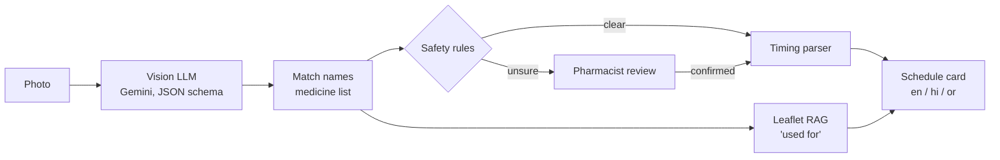

# Strip Reader

[](https://github.com/pranatipradhanwork-alt/strip-reader/actions/workflows/tests.yml)

**A safety-first reader for medicine strips, boxes and prescriptions, built for elderly users and weak networks.**

Many elderly people can't read the small print on a medicine strip or a doctor's prescription, so they ask someone else to. Strip Reader takes one photo and returns a simple daily medicine card in the person's language: what each medicine is, when to take it, and what it is used for. When the app is unsure, it **says so and sends the person to a pharmacist** instead of guessing. It never invents a dose.

---

## Features

- **Reads strips, boxes and prescriptions** with a vision LLM (Gemini) into structured data: name, strength, timing, printed vs handwritten, confidence and the region it was read from.
- **Verifies every name** against a medicine list of Indian generics and brands (brand → generic).
- **Abstains when unsure:** low confidence, handwriting, unknown names or missing strengths all lead to *"Please confirm with a pharmacist or doctor."*
- **Schedule card** (morning / afternoon / night, before or after food, number of days), built only from what is written.
- **"What is it for?"** from real medicine leaflets (RAG), with the source, and never a dose.
- **Pharmacist review page:** unsure items are checked against a photo of the label before they reach the card.
- **Multilingual:** English, Hindi and Odia, from reviewed translation files.
- **Read aloud:** the card as a small MP3 in the person's language, for users who can't read.
- **Low-network mode:** shrinks the photo only when the upload fails, queues photos when offline, and offers a ~1 KB text card for SMS/WhatsApp.

## How it works



| Stage | Module | What it does |
|---|---|---|
| Read | `strip_reader/vision.py` | Sends the photo to Gemini with a strict JSON schema. Text is copied exactly as written; each item gets a confidence score and a bounding box, used to save a crop of the label. |
| Match | `strip_reader/safety.py` | Matches each name to `data/medicines.csv`. Uses whole-name and word-set similarity, not partial matching, so a short brand can't match inside a longer name. |
| Safety | `strip_reader/safety.py` | Decides **OK** or **CONFIRM** (rules below). Merges a brand and its generic printed on the same strip into one item. |
| Timing | `strip_reader/timing.py` | Turns written timing into a schedule, only where it is explicit. |
| Card | `strip_reader/card.py` | Builds the text and HTML card in the chosen language. |
| Uses (RAG) | `strip_reader/leaflets.py` | Retrieves the medicine's leaflet text and writes one plain sentence on what it is used for. |
| Review | `strip_reader/confirm.py`, `web.py` | Pharmacist confirm page (Flask). |
| Voice | `strip_reader/voice.py` | Builds the spoken script from the card and turns it into MP3. |

## Safety design

An item is marked **OK** only if **all** of these hold:

| Check | Rule |
|---|---|
| Reading confidence | ≥ 0.80 |
| Source | printed (strip, box or printed prescription), not handwritten |
| Name | ≥ 90% match to the medicine list, with no extra words (e.g. "Brand Plus" ≠ "Brand") |
| Strength | looks like a real printed strength with a unit ("500 mg"); "40" alone is dropped, never guessed |
| Photo | not blurry, dark or cut off |

Everything else is **CONFIRM**, with the reasons shown. In addition:

- **Doses are never invented.** Strength and timing are copied text; anything missing stays empty.
- **Timing on a strip or box is not treated as a dose.** It is usually a pharmacy sticker or a pen mark, so it is shown with a warning. Only a printed prescription gives a schedule.
- **A medicine is put in a time slot only if** it is OK, its timing comes from a printed prescription, and the parser is sure.
- **Handwritten items are cross-checked** against printed strips in the same set of photos. Agreement is noted for the pharmacist but never turns an item into OK on its own.

## Timing parser

Only what is written is used:

| Written | Understood as | Placed on card? |
|---|---|---|
| `1-0-1`, `½-0-½`, `1-1-1-1`, Bengali/Hindi/Odia digits (`১-০-১`) | exact amounts per time of day | yes |
| `after food`, `PC`, `A/C`, `before food` | food timing | yes |
| `x 5 days`, `for 1 week`, `1 month` | duration | yes |
| `HS`, `at bedtime`, `before breakfast/lunch/dinner` | night / morning / afternoon | yes |
| `SOS for fever` | only when needed (fever) | yes |
| `OD`, `BD`, `TDS` | times per day, **but not which times**, so none are picked | no, pharmacist |
| `BF` | ambiguous ("before food" or "breakfast") | no, pharmacist |
| anything else | listed as unclear | no, pharmacist |

## "What is it for?" (leaflet RAG)

1. **Leaflets:** official label text from the US FDA (openFDA, public domain) for 97 of the 112 generics in the list. Indian names are mapped to US names (Paracetamol → acetaminophen). Only uses, warnings, contraindications and side effects are kept. **The dosage section is never stored.**
2. **Index:** 558 chunks (~600 characters each) embedded with `gemini-embedding-001` (768-d) in `data/leaflets/index.npy`.
3. **Retrieve:** first filter to the one medicine whose name was already verified, then rank that medicine's chunks by cosine similarity. An answer can never come from another medicine's leaflet.
4. **Generate:** Gemini writes one short sentence in everyday words (at most ~20 words) from those chunks only, in the card's language, and the answer is cached.
5. **Dose guard:** any answer mentioning a dose, amount or frequency (in any of the three languages) is discarded.

"Used for" is shown only for clearly read printed items, or after a pharmacist confirms a handwritten one. A fixed line is always added: *"Your doctor may have prescribed it for a different reason"*, because labels list only officially approved uses.

## Pharmacist review

`python -m strip_reader.web <run folder>` opens a review page listing every item not yet on the card, with its label crop and the reasons. The pharmacist can **confirm** (correcting the name, strength or timing), mark it **not a medicine**, or **leave it for the doctor**.

- What the pharmacist enters passes the same rules: the strength needs a unit, and the timing must say *when*.
- The pharmacist's name is required.
- If any entry is invalid, nothing is saved.
- Confirmed items appear on the card with a ✓. Each confirmation records who, when and which fields changed, and can be undone.

## Read aloud

`--voice` saves the card as `card.mp3` (or use "read aloud" on the review page).

- **The words are built by code, not by an AI.** The script comes only from the card and the reviewed language files, so the voice can't say a dose or timing that isn't on the card. Gemini's text-to-speech model (`gemini-3.8-flash-lite-tts`) only reads it.
- "Used for" is said once per medicine. Unsure items are only named under "ask your pharmacist first", never with a dose.
- The audio is a 32 kbps MP3 (~4 KB per second), cached so the same card is never generated twice. If speech fails, the card still works.
- **Checked by transcription:** the Odia audio for a 6-medicine demo card was transcribed back to text; it matched the script, and every number (500, 1, 30, 40, 10, 650) was spoken correctly.

## Low-network mode

| Situation | Behaviour |
|---|---|
| Upload fails | Retries with a smaller photo: normal (~200 KB) → low (~80 KB) → tiny (~40 KB, greyscale) |
| No network | Photo saved to a local queue, never lost; the card says so in the user's language; `--flush-queue` reads it later |
| Model busy or slow (429/503/504) | Waits and retries, then queues instead of failing |
| Same photo again | Answer reused from a content-hash cache, so it is never uploaded twice |
| Images can't load | `card.txt` (~1 KB) for SMS/WhatsApp; `--no-crops` for a minimal HTML card |

Average upload on 2G (50 kbps): **28 s** for the original photo, **13 s** at low and **6 s** at tiny.

## Languages

All user-facing text lives in `data/i18n/<lang>.json`, and each safety reason has a code that is translated on the card. Odia has been reviewed by a native speaker; Hindi is a draft pending review. Safety messages are fixed, reviewed text and are never translated live by an LLM, so they can't drift and they work offline. To add a language, add one file; the tests check that no phrase or placeholder is missing.

## Results so far

A pilot run on **12 real photos** (6 handwritten prescriptions, 6 printed strips/boxes):

| | |
|---|---|
| Medicines read | 28 |
| Marked OK | 4, all printed strips/boxes, all correct |
| Marked CONFIRM | 24, including every handwritten item |
| Unsafe passes (wrong item marked OK) | **0** |

Upload-size check (3 photos at each size): printed strips read the same at all sizes; handwriting degraded at smaller sizes; no size produced a wrong OK. The photo is therefore shrunk only when the network forces it.

The pilot is small and the medicine list includes brands seen in it. A larger, unseen, multi-region test set with a labelled evaluation (per-field accuracy, safe-failure rate, unsafe-pass rate) is in progress.

## Design decisions

- **Exact matching for names, vector search only for leaflets.** Similar-looking drug names can be different drugs, so identification must be exact. Semantic search is used only once the medicine is known.
- **A numpy index instead of a vector database server.** At ~600 chunks, an in-memory cosine search is instant; a separate server would add setup without speed.
- **Abstain over guess.** A wrong dose or a wrong "use" is worse than "ask your pharmacist".
- **Reviewed translations over live translation** for every safety message.

## Quick start

```bash
git clone https://github.com/pranatipradhanwork-alt/strip-reader.git
cd strip-reader
python3 -m venv .venv && source .venv/bin/activate
pip install -r requirements.txt
cp .env.example .env            # add your GEMINI_API_KEY
```

Try it **without an API key** (uses a saved model reply):

```bash
python -m strip_reader.cli tests/fixtures/printed_rx.png --mock tests/fixtures/printed_rx_reply.json --lang hi --no-uses
```

Read your own photos:

```bash
python -m strip_reader.cli photo1.jpg photo2.jpg --out out/run1 --lang or
python -m strip_reader.web out/run1          # pharmacist review at http://127.0.0.1:5050
```

| Option | Meaning |
|---|---|
| `--lang en\|hi\|or` | card language |
| `--network normal\|low\|tiny` | starting upload size (it steps down by itself on failure) |
| `--flush-queue` | read photos saved while offline |
| `--no-crops` | smallest HTML card |
| `--no-uses` | skip "what it's for" (no extra API calls) |
| `--voice` | also save the card read aloud as `card.mp3` |
| `--mock reply.json` | use a saved model reply instead of calling Gemini |

Each run writes `result.json`, `schedule.json`, `card.html` and `card.txt` (and `card.mp3` with `--voice`) to the output folder.

Rebuild the leaflet data (optional): `python scripts/build_leaflets.py && python scripts/build_index.py`.

## Project structure

```
strip_reader/
  vision.py      photo -> Gemini -> structured items; upload profiles, retries
  safety.py      medicine-list matching and OK / CONFIRM rules
  timing.py      timing text -> schedule (explicit only)
  card.py        schedule + text / HTML card
  leaflets.py    leaflet RAG and dose guard
  confirm.py     pharmacist confirmation rules
  voice.py       card -> spoken script -> MP3
  web.py         pharmacist review page (Flask)
  cli.py         command line
data/
  medicines.csv  generics and brands
  i18n/          card text per language
  leaflets/      FDA leaflet sections + embedding index
scripts/         build_leaflets.py, build_index.py
tests/           79 tests, no API key needed
```

## Testing

```bash
pytest -q
```

All tests run offline with saved model replies, and they run on every push and pull request (GitHub Actions).

## Limitations

- Handwritten prescriptions always need a pharmacist; the app does not try to make them OK on its own.
- Leaflets come from US labels. Medicines not sold in the US (e.g. Drotaverine, many Domperidone combinations) have no "used for" line, and approved uses can differ from how doctors in India prescribe.
- The medicine list is limited (~180 entries); medicines not in it are always CONFIRM.
- Evaluation so far is a small pilot.

## Roadmap

- Larger medicine list (full Indian brand list, Jan Aushadhi)
- Labelled multi-region test set and evaluation report
- WhatsApp interface: send a photo, get the card and a voice note
- Free questions over the leaflet index ("can I take it with milk?")
- Caregiver mode and generic/Jan Aushadhi suggestions

## Disclaimer

Strip Reader is a reading aid, not medical advice. Always check with a pharmacist or doctor before taking any medicine.

Leaflet data: [openFDA](https://open.fda.gov/) drug labels (public domain).
